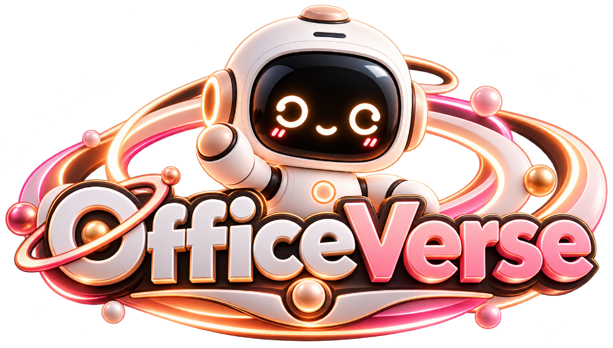
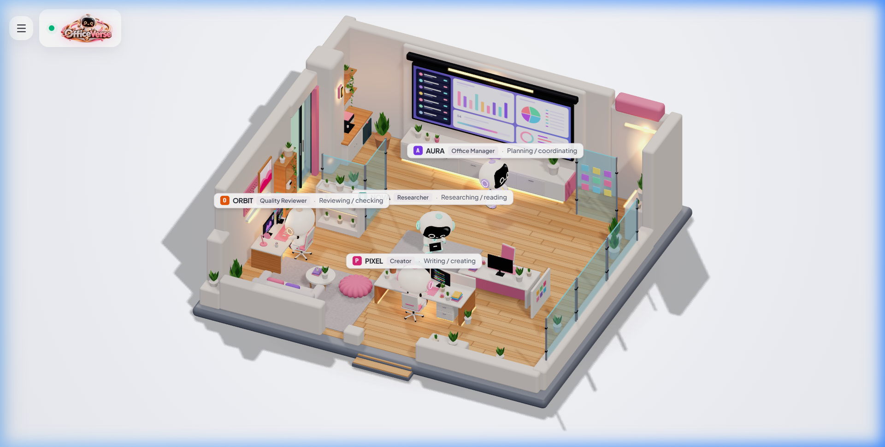

<div align="center">

  

  # OfficeVerse — 3D Multi-Agent Virtual Office

  **An interactive 3D isometric virtual workspace where autonomous AI companion robots collaborate, plan, code, and review in real-time.**

  [](https://react.dev/)
  [](https://threejs.org/)
  [](https://www.typescriptlang.org/)
  [](https://vitejs.dev/)
  [](https://tailwindcss.com/)
  [](LICENSE)

  <br />
  <br />

  

</div>

---

## 🌟 Overview

**OfficeVerse** brings multi-agent AI collaboration into a tangible, delightful 3D isometric diorama. Built with **Three.js** and **React 19**, it simulates a vibrant pastel co-working studio where 4 specialized companion robots work together across an agile production workflow.

Features a pristine **infinite white studio surface** with **real-time PCF soft contact shadows**, an intuitive **slide-out hamburger control center**, and interactive employee badging.

---

## 🤖 Meet the AI Team

| Employee | Role | Station | Specialty |
|:---:|:---|:---|:---|
|  **AURA** | **Office Manager** | Team Dashboard & Analytics Wall | Project decomposition, backlog sprint planning & dependencies |
|  **NOVA** | **Lead Researcher** | Central Hex Tablet Island | Source aggregation, paper analysis & research summarization |
|  **PIXEL** | **Full-Stack Creator** | Foreground Dual-Monitor Station | Full-stack engineering, code generation & artifact building |
|  **ORBIT** | **Quality Reviewer** | Left-Wall Dual-PC Desk | Static code analysis, test verification, QA & security checks |

---

## ✨ Features

- 🏢 **Handcrafted 3D Isometric Diorama**
  - Procedural oak plank flooring with natural grain variation.
  - Architectural glass partitions, fluted walls, and ceiling recesses.
  - Lounge with pastel pink poufs, espresso bar, and indoor potted botanicals.
  - Holographic interactive planning boards and dual-monitor workstations.

- ☀️ **Studio White Surface & Real-time Soft Shadows**
  - Pure studio cyclorama background with directional key lighting and ambient fill.
  - Real-time `PCFSoftShadowMap` contact shadows cast onto the white ground plane.

- 🍔 **Collapsible Drawer Control Center**
  - Uncluttered canvas with a sleek top-left glassmorphic brand badge.
  - Slide-out drawer with full controls: camera views, workflow stage progression, robot targeting, and behavioral routines.

- 🎭 **Dynamic Facial Expressions & Behavior Modes**
  - **8 Facial Expressions**: `Happy`, `Excited`, `Wink`, `Love`, `Curious`, `Surprised`, `Sleepy`, `Sad` (+ interactive eye blinking).
  - **10 Animation Actions**: `Work Task`, `Idle`, `Patrol`, `Wave`, `Dance`, `Bounce`, `Celebrate`, `Head Tilt`, `Bow`, `Sleep`.

- ⚡ **Camera Director Mode**
  - Smooth animated transitions between studio isometric overview and focused employee zoom-ins.
  - OrbitControls with bounded rotation and damping.

---

## 🎮 Keyboard Shortcuts

| Key | Action |
|:---|:---|
| <kbd>M</kbd> or <kbd>H</kbd> | Toggle Left Controls Drawer |
| <kbd>Esc</kbd> | Close Controls Drawer |
| <kbd>0</kbd> | Reset Camera to Studio Overview |
| <kbd>1</kbd> | Focus Camera on **AURA** (Office Manager) |
| <kbd>2</kbd> | Focus Camera on **NOVA** (Researcher) |
| <kbd>3</kbd> | Focus Camera on **PIXEL** (Creator) |
| <kbd>4</kbd> | Focus Camera on **ORBIT** (Reviewer) |

---

## 🚀 Getting Started

### Prerequisites

- [Node.js](https://nodejs.org/) (v18 or higher recommended)
- `npm` or `bun`

### Installation

1. **Clone the repository:**
   ```bash
   git clone https://github.com/AyaanAli73/OfficeVerse.git
   cd OfficeVerse
   ```

2. **Install dependencies:**
   ```bash
   npm install --legacy-peer-deps
   ```

3. **Start the development server:**
   ```bash
   npm run dev
   ```

4. **Open in browser:**
   Navigate to [http://localhost:3000](http://localhost:3000)

---

## 🏗️ Project Architecture

```
officeverse/
├── public/
│   ├── officeverse-logo.png     # 3D Robot Logo Mark
│   └── screenshot.png           # High-resolution Studio Preview
├── src/
│   ├── scene/
│   │   ├── companionRobotBuilder.ts   # 3D robot hierarchy, materials & procedural animations
│   │   └── officeEnvironmentBuilder.ts # Architectural meshes, lighting & shadow receiver
│   ├── utils/
│   │   └── robotTasks.ts              # Agent configurations, workflows & state machines
│   ├── App.tsx                        # Main UI, OrbitControls loop & Drawer menu
│   ├── index.css                      # Tailwind styling, Google Fonts & white studio gradient
│   └── main.tsx                       # React application root
├── index.html                         # Page template & SEO metadata
├── package.json
└── vite.config.ts
```

---

## 🛠️ Built With

- **[Three.js](https://threejs.org/)** — 3D WebGL isometric rendering & shadow engine
- **[React 19](https://react.dev/)** — Declarative UI layer & reactive state management
- **[TailwindCSS v4](https://tailwindcss.com/)** — Modern glassmorphism & utility design
- **[Lucide React](https://lucide.dev/)** — Streamlined UI iconography
- **[Vite](https://vitejs.dev/)** — Lightning fast build tool & HMR

---

## 📄 License

This project is open-source under the [MIT License](LICENSE).
